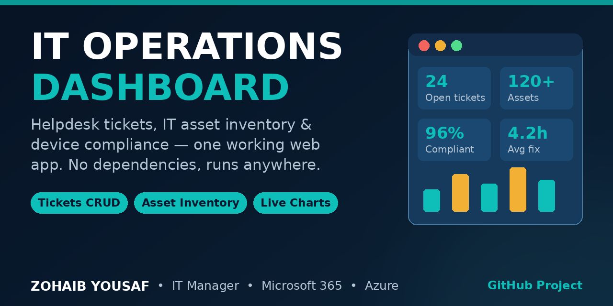

# IT Operations Dashboard



A dependency-free web app for day-to-day IT operations: support-ticket management, device asset inventory, compliance tracking and operational KPIs — built with pure HTML, CSS and JavaScript. No build step, no frameworks, no CDN libraries. Open `index.html` and it works.

> **Screenshot:** Dashboard view with a dark sidebar, four KPI cards (open tickets, total assets, device compliance %, average resolution time), two canvas bar charts (tickets by status and by priority), and a recent-tickets table. Tickets and Assets views provide full create / edit / delete tables with live search and filters.

## Features

- **Dashboard overview** — KPI cards for open tickets, total assets, device compliance percentage and average resolution time, recalculated live from your data
- **Hand-rolled canvas charts** — tickets by status and by priority, drawn with the Canvas API (DPR-aware, no Chart.js or any other library)
- **Tickets module** — full CRUD with title, description, requester, assignee, status (`Open / In Progress / Resolved / Closed`), priority (`Critical / High / Medium / Low`) and resolution time; live search plus status and priority filters
- **Assets module** — full CRUD inventory: asset tag, device, type, assigned user, status (`In Use / In Stock / In Repair / Retired`) and compliance (`Compliant / Non-compliant`); live search plus status and compliance filters
- **Persistent by default** — all data is saved in `localStorage`, with realistic seed data on first run and a one-click “Reset demo data” option
- **Clean, accessible UI** — dark sidebar layout, responsive down to mobile, labelled controls, skip link, visible focus states and `prefers-reduced-motion` support
- **Safe rendering** — user input is escaped before it reaches the DOM

## Tech Stack

| Layer | Technology |
|---|---|
| Markup | Semantic HTML5, `<dialog>` for forms, ARIA labels |
| Styling | Modern CSS — custom properties, Grid, Flexbox, responsive breakpoints |
| Logic | Vanilla JavaScript (ES2022), Canvas API, `localStorage` |
| Tooling | None — no bundler, no dependencies, no build step |

## How to Run

**Option 1 — just open it**

Double-click `index.html` in any modern browser. That is all.

**Option 2 — local server (optional)**

```bash
# Python
python3 -m http.server 8000
# then visit http://localhost:8000
```

**Option 3 — GitHub Pages**

Push this repository to GitHub, then go to **Settings → Pages → Deploy from a branch → `main` / root**. The app is static and works on Pages as-is.

## Project Structure

```
it-operations-dashboard/
├── index.html   # Semantic layout: sidebar, dashboard / tickets / assets views, dialogs
├── styles.css   # Design system, layout, tables, pills, responsive rules
├── app.js       # Store (localStorage + seed), KPIs, canvas charts, CRUD, filters
├── LICENSE      # MIT
└── README.md
```

## What This Demonstrates

This project mirrors the work of an IT Manager / Digital Operations role: ticket triage by priority and status, endpoint compliance tracking in the style of Microsoft Intune, asset lifecycle management (in use → in stock → in repair → retired), and reporting the numbers a support operation is judged on — open workload, compliance rate and resolution time.

Possible next steps: CSV export, due-date / SLA tracking, and a backend API version (Node.js + SQLite) for multi-user use.

## Author

**Zohaib Yousaf** — IT Manager / Digital Operations, based in Islamabad, Pakistan.
6+ years of experience across SCCM/Intune, Microsoft 365, Azure and LAN/WAN operations, alongside web development (WordPress / Shopify). BS-IT, Bahauddin Zakariya University (BZU), Multan, 2023. IBM Web Developer certification, 2024.

- Website: [zohaibyousaf.com](https://zohaibyousaf.com)
- LinkedIn: [linkedin.com/in/zohaibyousaf](https://linkedin.com/in/zohaibyousaf)
- Email: [info@zohaibyousaf.com](mailto:info@zohaibyousaf.com)

## License

MIT — see [LICENSE](LICENSE).
